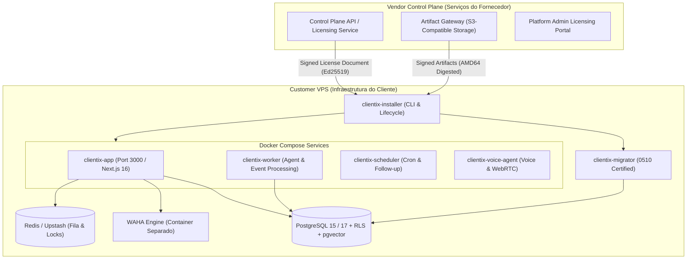

<div align="center">

# 🛠️ Clientix Agência

### Plataforma Comercial e Operacional de Atendimento, CRM, Automação e IA

**Sistema operacional de vendas e relacionamento multi-tenant, disponível em Cloud gerenciada e em instalações self-hosted licenciadas.**

[](https://nextjs.org)
[](https://react.dev)
[](https://www.typescriptlang.org)
[](https://tailwindcss.com)
[](https://supabase.com)
[](https://www.docker.com)
[](LICENSE)

[**⚡ Instalação Comercial**](#-instalação-comercial-oficial) · [**🔄 Atualizações**](#-atualização-e-manutenção) · [**🏗️ Arquitetura**](#%EF%B8%8F-arquitetura) · [**🔑 Licenciamento**](#-licenciamento-comercial) · [**🧑‍💻 Desenvolvimento**](#-ambiente-de-desenvolvimento) · [**📜 Legal**](#-aspectos-jurídicos-e-licenciamento)

</div>

---

> ### ⚠️ Aviso Importante sobre Instalação e Distribuição Comercial
>
> As instalações comerciais em clientes finais e parceiros devem utilizar **exclusivamente o instalador oficial (`distribution/installer/`)** e os **artefatos de release assinados** com verificação criptográfica de digest.
> As instruções de compilação a partir do código fonte (`git clone`, `pnpm install`, `pnpm dev`) destinam-se exclusivamente ao ambiente interno de desenvolvimento e contribuição técnica.
> A distribuição comercial não requer nem concede acesso ao repositório de código fonte.

---

## 🧭 Visão Geral

O **Clientix Agência** é uma plataforma robusta de operações comerciais, gestão de relacionamento (CRM), automação de processos e atendimento multicanal (WhatsApp/WAHA, voz e mensageria digital) com isolamento nativo multi-tenant e suporte a agentes de IA integrados.

O sistema oferece dois modelos. Empresas que contratam diretamente acessam uma instalação Cloud multi-tenant gerenciada pelo projeto e têm plano, cotas e período vinculados ao seu tenant. Empresas e parceiros também podem instalar o produto open source em VPS própria; nessa modalidade, a licença `ACT_...` autoriza a instalação inteira, e cada organização pode ter sua própria assinatura comercial se o proprietário optar por cobrar seus tenants. Os registros de assinatura por tenant ficam no banco Customer; o licenciamento `ACT_...` continua separado no Control Plane Vendor.

A plataforma combina flexibilidade de vocabulário e funis de vendas para múltiplos nichos (agências, clínicas, imobiliárias, infoprodutos, e-commerce e serviços corporativos), mantendo governança rigorosa de acessos por papéis (RBAC) e proteção em profundidade via Row Level Security (RLS) no PostgreSQL.

---

## ✨ Principais Capacidades e Módulos

Todos os módulos abaixo possuem implementação real no código da aplicação (`app/app/` e `app/api/v1/`):

- 💬 **Inbox e Atendimento Multicanal:** Atendimento em tempo real com painel integrado, suporte a múltiplos números, fila com rodízio, transferência auditada e coexistência transparente entre operadores humanos e agentes autônomos.
- 👥 **Operação 100% Humana Suportada:** A utilização de inteligência artificial é estritamente opcional. A plataforma opera de forma completa e estável em modo puramente humano, sem exigir chaves de API externas de LLM para suas funções essenciais de CRM, mensageria e automação.
- 📊 **CRM e Kanban Comercial:** Gestão de oportunidades em pipelines visuais, ordenação contínua (`fractional indexing`), vocabulário configurável por nicho (_Lead/Cliente/Paciente_, _Ganho/Fechado/Agendado_) e motivos estruturados de perda.
- 📇 **Contatos, Empresas e Customer 360:** Base unificada de clientes com histórico de interações, campos personalizados, etiquetas (tags), notas internas e controle de consentimento LGPD.
- 📅 **Agenda e Agendamentos:** Gestão de compromissos com suporte a sincronização bidirecional com Google Calendar e buffers de atendimento.
- 🤖 **Agentes de IA e RAG por Tenant:** Automação inteligente opcional alimentada por busca semântica em base de conhecimento própria (`pgvector`), memória da organização, execução de competências operacionais (skills) e transferência orientada por regras (handoff com gate humano).
- 🔁 **Radar e Follow-up Contínuo:** Monitoramento proativo de negociações e conversas estagnadas, prevenindo perda de oportunidades sem atendimento.
- ⚡ **Webhooks e Automações QUANDO/SE/ENTÃO:** Captura de leads via endpoints públicos dedicados (`/api/v1/webhooks/in/<token>`) integráveis a formulários, landing pages e ferramentas externas, com execução assíncrona desacoplada via `event_log`.
- 🛡️ **Segurança e Conformidade LGPD:** Autenticação robusta (`@supabase/ssr` com cookies `SameSite=Strict`), MFA TOTP opcional para administradores, trilha de auditoria append-only, fluxos de exportação e expurgo/anonimização de dados pessoais.
- 🏷️ **White-Label e Marca Própria:** Capacidade comercial regulada por licença que permite a agências parceiras personalizar logotipos, identidade visual e domínios para seus clientes finais.

---

## 🏗️ Arquitetura

O sistema adota uma separação arquitetural rigorosa entre o ambiente do cliente e os serviços do fornecedor:



### Componentes Principais:

1. **Customer VPS:**
   - **`clientix-app`:** Aplicação principal (App Router Next.js 16, UI e API REST versionada).
   - **`clientix-worker`:** Processamento em segundo plano da fila de eventos (`event_log`), execuções de automação e RAG.
   - **`clientix-scheduler`:** Agendador de tarefas periódicas, crons do sistema e rotinas de follow-up.
   - **`clientix-voice-agent`:** Processamento de mídia e integração de chamadas de voz.
   - **`clientix-migrator`:** Utilitário standalone certificado para aplicação idempotente de schema e diagnósticos de banco.
   - **PostgreSQL com RLS:** Banco relacional com isolamento estrito entre organizações e extensão `pgvector`.
2. **Vendor Control Plane (Externo à VPS do Cliente):**
   - **Licensing Service:** Emissão de documentos de licença assinados criptograficamente, verificação de quotas e controle de leases temporários.
   - **Artifact Gateway:** Distribuição de releases com grants temporários opacos e verificação de integridade por digest imutável.
   - **Platform Admin Licensing Portal:** Gestão centralizada de clientes, licenças comerciais e auditoria de ativações.

---

## 🧱 Stack Tecnológica

| Camada                     | Tecnologia                                                              | Justificativa Técnica                                                                           |
| -------------------------- | ----------------------------------------------------------------------- | ----------------------------------------------------------------------------------------------- |
| **Framework Web**          | Next.js 16 (App Router, Turbopack)                                      | Server Components e Route Handlers integrados no mesmo repositório                              |
| **Interface & UI**         | React 19 + TypeScript (strict)                                          | Concorrência moderna, tipagem estrita (`noUncheckedIndexedAccess`)                              |
| **Estilização**            | Tailwind CSS 4 + shadcn/ui (`new-york`)                                 | Configuração via CSS tokens, sem dependência de temas externos proprietários                    |
| **Banco de Dados**         | PostgreSQL (versões 15 e 17 certificadas)                               | Supabase Postgres, RLS nativo para isolamento multi-tenant, pgvector                            |
| **Autenticação**           | Supabase Auth via `@supabase/ssr`                                       | Cookies HttpOnly protegidos com política SameSite estrita (Strict padrão / Lax em fluxos OAuth) |
| **Comunicação Tempo Real** | Supabase Realtime                                                       | Notificações de mensagens (`postgres_changes`) e broadcast                                      |
| **Mensageria WhatsApp**    | WAHA (engine NOWEB) + Meta Cloud API                                    | Integração via container segregado por chamadas HTTP REST / Webhooks                            |
| **IA & Embeddings**        | Vercel AI SDK (`@ai-sdk/anthropic`, `@ai-sdk/openai`, `@ai-sdk/google`) | Catálogo multi-provedor (OpenRouter, Anthropic, OpenAI, Google) configurável pela tela          |
| **Filas & Eventos**        | Tabela `event_log` + Workers dedicados                                  | Padrão event sourcing leve; triggers de banco nunca executam chamadas HTTP                      |
| **Cache & Locks**          | Redis / Upstash                                                         | Controle de concorrência, rate limiting e leases de distribuição                                |
| **Validação de Dados**     | Zod 4                                                                   | Validação estrita de contratos de entrada na borda da API e env vars                            |
| **Observabilidade**        | Sentry SDK (Node/Next.js)                                               | Monitoramento opcional com higienização estrita de dados sensíveis na origem                    |
| **Runtime de Produção**    | Docker + Docker Compose v2                                              | Empacotamento em contêineres imutáveis com digest pinning                                       |

---

## 📦 Modelo de Artefatos de Release

O Clientix Agência é empacotado e distribuído em 5 imagens de contêineres oficiais:

| Artefato        | Imagem de Referência         | Função no Sistema                                          |
| --------------- | ---------------------------- | ---------------------------------------------------------- |
| **App**         | `clientix-app:1.0.0`         | Interface do usuário e API REST pública/autenticada        |
| **Worker**      | `clientix-worker:1.0.0`      | Dreno da fila de eventos, rotinas assíncronas e automações |
| **Scheduler**   | `clientix-scheduler:1.0.0`   | Disparos temporais, sincronizações periódicas e crons      |
| **Voice Agent** | `clientix-voice-agent:1.0.0` | Processamento de streaming de áudio e telefonia            |
| **Migrator**    | `clientix-migrator:1.0.0`    | Utilitário isolado para aplicação e validação de schema    |

### Suporte de Arquitetura:

- **`linux/amd64`:** **Oficialmente suportado e certificado** para ambientes de produção.
- **`linux/arm64`:** **Experimental / Parcial** (suporte técnico restrito; não recomendado para ambientes de produção comercial crítica).

---

## ⚡ Instalação Comercial Oficial

> 🔒 O processo de instalação comercial é **idempotente, atômico e não requer compilação de código**. O cliente ou operador nunca necessita de credenciais de repositório Git ou tokens de acesso ao código fonte.

### 1. Requisitos Mínimos de Servidor (VPS)

- **CPU:** 2 vCPUs (x86_64 / amd64).
- **Memória RAM:** 4 GB de memória física disponível (mínimo recomendado para app, workers e Postgres).
- **Armazenamento:** 20 GB SSD livre.
- **Sistema Operacional:** Ubuntu 22.04 LTS ou Debian 12 com Docker Engine v24+ e Docker Compose v2 instalados.
- **Rede e Conectividade:** Endereço IP público com registro DNS tipo **A** configurado apontando para a máquina.

### 2. Fluxo de Instalação Comercial

No servidor de produção do cliente, execute o utilitário oficial:

```bash
# Navegue até o diretório do instalador oficial
cd /opt/clientix/installer

# Execute o instalador oficial (suporta verificações de pré-vôo e setup de banco)
bash install.sh install
```

O instalador executa automaticamente as seguintes etapas:

1. **Preflight Checks:** Valida espaço em disco (mínimo 2 GB livres), arquitetura (`amd64`), daemon Docker ativo e Compose v2.
2. **Inicialização de Segredos:** Gera credenciais e segredos locais via CSPRNG (`NEXTAUTH_SECRET`, `ENCRYPTION_KEY`, `INTERNAL_CRON_SECRET`), garantindo a geração atômica e persistência do `installation_id` exclusivo do servidor.
3. **Validação do Manifesto de Release:** Confere o manifesto assinado da release (`release-manifest.json`), verificando a versão alvo (`1.0.0`), schema (`0510`) e os digests SHA-256 das 5 imagens.
4. **Download e Verificação de Imagens:** Realiza o pull dos contêineres e valida os hashes SHA-256 contra o manifesto assinado.
5. **Aplicação do Migrator:** Executa `clientix-migrator status` e, caso o banco esteja limpo, executa `clientix-migrator install`.
6. **Boot e Validação de Saúde:** Inicia os serviços via Docker Compose (com a porta de aplicação configurada por `${PORT:-3000}` no compose comercial) e aguarda resposta positiva dos probes HTTP (`/login` e `/api/v1/health`).
7. **Promoção de Estado Atômico:** Registra o estado da instalação em `/opt/clientix/state/release.json`.

---

## 🔑 Licenciamento Comercial

O Clientix Agência opera sob um modelo de licença comercial validado localmente com criptografia assimétrica de curva elíptica:

- **Identificador de Instalação (`installation_id`):** Identificador exclusivo gerado no primeiro setup (`inst_<UUIDv4>`). O runtime adota resolução determinística: a variável de ambiente `INSTALLATION_ID` (injetada via `.env` do contêiner) é a autoridade prioritária; na sua ausência, o arquivo persistente em `/opt/clientix/state/installation_id` opera como fonte autoritativa atômica com trava de concorrência. O registro em `release.json` atua estritamente como snapshot de auditoria de deploy. Divergências ou arquivos vazios disparam parada imediata (_fail-closed_).
- **Assinatura Assimétrica Ed25519:** Todas as licenças emitidas contêm assinaturas digitais verificáveis pela chave pública do fornecedor embarcada no código, sem necessidade de consultas síncronas bloqueantes a servidores externos.

- **Entitlements Contratuais:** As permissões da instância são definidas estritamente pelos _entitlements_ expressos no documento de licença, e não apenas pelo nome do plano:
  - `max_installations`: Número de servidores autorizados para o cliente.
  - `max_tenants`: Quantidade máxima de organizações/empresas atendidas (inteiro positivo ou ilimitado).
  - `resale_allowed`: Autorização comercial para sublicenciamento e revenda de acessos.
  - `white_label`: Autorização para personalização visual completa da interface e relatórios.
  - `features`: Matriz de funcionalidades corporativas liberadas para a instância.
- **Ciclo de Vida da Licença:**
  - `VALID`: Licença em vigência com operação regular de todos os recursos.
  - `GRACE`: Período de tolerância temporário para renovação contratual.
  - `EXPIRED` / `SUSPENDED`: Suspensão de automações e envios proativos externos, **mantendo o acesso administrativo local integral para geração de backups e exportação de dados**.
  - `REVOKED`: Licença cancelada administrativamente por violação contratual grave.
- **Operação Offline:** O motor de validação (`lib/licensing/`) valida a validade temporal diretamente no documento assinado local (`/opt/clientix/licenses/license.json`), permitindo resiliência operacional mesmo durante instabilidades momentâneas de conexão com o Control Plane.

---

## 🏢 Planos de Organização (Tenant Plans)

Dentro de uma instalação licenciada, cada organização/empresa cadastrada pode ser vinculada a um plano operacional (`lib/tenant/plan-limits.ts`):

| Plano          | Limite Padrão de Assentos | Canais Permitidos            | Recursos Inclusos                                               |
| -------------- | ------------------------- | ---------------------------- | --------------------------------------------------------------- |
| **Standard**   | Até 3 usuários            | 1 canal (WhatsApp ou E-mail) | Inbox, CRM/Kanban, Atendimento Humano, RAG Básico               |
| **Pro**        | Até 10 usuários           | Até 5 canais simultâneos     | Campanhas, Automações Avançadas, Agentes de IA, Chamadas de Voz |
| **Enterprise** | Ilimitado (customizado)   | Ilimitado                    | Múltiplos funis, limites ampliados, integrações corporativas    |

> 💡 **Nota de Isolamento:** Os limites da organização (_Tenant Plan_) gerenciam cotas de uso do CRM, enquanto a _Licença de Instalação_ regula a operação legal do servidor como um todo.

---

## 🔄 Atualização e Manutenção

As atualizações de versão do Clientix Agência são projetadas para serem previsíveis e seguras, com backup preventivo mandatório:

```bash
# Executa a atualização atômica para a versão especificada no manifesto
bash /opt/clientix/installer/install.sh update
```

### Sequência do Procedimento de Atualização:

1. **Preflight e Verificação de Manifesto:** Confere requisitos e integridade da versão de destino.
2. **Download Preventivo de Imagens:** Todas as imagens da nova versão são baixadas e verificadas via digest antes de qualquer alteração no sistema existente.
3. **Backup Lógico Automático:** O utilitário executa um dump binário customizado (`pg_dump -Fc`) do banco de dados e valida sua legibilidade via `pg_restore --list`. Se o backup falhar, a atualização é abortada imediatamente.
4. **Migrações Incrementais de Banco:** O `clientix-migrator` aplica as migrations pendentes de forma sequencial com confirmação de backup (`--backup-ack`).
5. **Atualização de Contêineres:** Os contêineres são reiniciados sob a nova definição do Compose.
6. **Validação de Saúde:** Probes HTTP verificam a resposta dos serviços por até 45 segundos.
7. **Promoção de Estado:** O arquivo de estado é atualizado com o hash da versão e o caminho do backup correspondente.

### Política de Rollback:

- O rollback da aplicação para a versão de contêiner anterior é suportado de forma imediata quando as alterações de schema de banco forem retrocompatíveis.
- **Rollback de Banco de Dados:** Não há reversão automática destrutiva de schema de banco de dados. Caso seja necessário retornar a um estado anterior incompatível, deve-se realizar o restore manual a partir do arquivo de backup gerado.

---

## 💾 Backup e Restauração

### 1. Rotina de Backup

Os backups lógicos são gerados no formato binário comprimido do PostgreSQL (`-Fc`) no diretório `/opt/clientix/backups/`:

```bash
# Backup manual utilizando contêiner utilitário
docker run --rm \
  --network host \
  postgres:17-alpine \
  pg_dump "$DATABASE_URL" -Fc > "/opt/clientix/backups/backup_manual_$(date +%Y%m%d_%H%M%S).dump"
```

A política padrão do instalador mantém retidos os últimos 5 backups (`KEEP_LAST_N_BACKUPS=5`), removendo versões mais antigas de forma segura.

### 2. Validação e Restauração

Para verificar o catálogo de integridade de um arquivo de backup antes da restauração:

```bash
docker run --rm \
  -v /opt/clientix/backups:/backups:ro \
  postgres:17-alpine \
  pg_restore --list /backups/NOME_DO_ARQUIVO.dump
```

A restauração de um backup sobrescreve o schema de dados e deve ser realizada com os serviços da aplicação paralisados (`docker compose down`).

---

## 🛡️ Segurança e Privacidade

- **Isolamento de Dados Multi-Tenant:** Implementado via Row Level Security (RLS) no PostgreSQL em todas as tabelas contendo dados de organizações. As políticas utilizam funções seguras `SECURITY DEFINER` (`fn_user_org_ids()`).
- **Comunicação e Sessões:** Autenticação gerenciada via `@supabase/ssr` com cookies protegidos (`HttpOnly`, `Secure` em HTTPS e `SameSite=Strict` como regra padrão do produto, com `SameSite=Lax` reservado estritamente para callbacks OAuth externos). Rotas administrativas contam com guards específicos de autorização RBAC.
- **Criptografia de Credenciais e Segredos:** Chaves de API de provedores de IA (`ai_provider_credentials`) e conexões de bancos externos são armazenadas cifradas no banco via AES-256-GCM com IV de 12 bytes e tag de 16 bytes gerenciados pelo Node.js crypto (`lib/crypto/aes_gcm.ts`), utilizando a chave simétrica de produção `AI_CRED_AES_KEY` (32 bytes em base64). Segredos operacionais locais adicionais são protegidos pelas respectivas chaves da instalação (`ENCRYPTION_KEY` e chaves específicas de integração).

- **Assinaturas Criptográficas:** Assinatura digital Ed25519 em documentos de licenciamento e manifestos de release.
- **Trilha de Auditoria:** Registro append-only de eventos sensíveis (logins, alterações de permissão, acessos LGPD e criação de licenças).
- **Suspensão Não-Destrutiva:** Em caso de expiração ou suspensão comercial de licença, o sistema restringe fluxos automatizados, mas **nunca destrói dados nem impede a extração de cópias de segurança**.

---

## 🧑‍💻 Ambiente de Desenvolvimento

Esta seção destina-se **exclusivamente a engenheiros e mantenedores** que desenvolvem ou corrigem o código fonte do Clientix Agência.

### 1. Pré-requisitos de Desenvolvimento

- **Node.js:** Versão 22 LTS ou superior.
- **Gerenciador de Pacotes:** `pnpm` (versão 9.15+ recomendada).
- **Docker & Docker Compose:** Para execução de serviços locais de teste (Postgres e WAHA).
- **Windows:** Git for Windows com Git Bash para os comandos da stack local.

### 2. Instalação local nova

```bash
# Clone limpo e dependências do lockfile
git clone https://github.com/rafaelbravik/clientix.git clientix
cd clientix
pnpm install --frozen-lockfile

# Gera ambiente local, cria bancos vazios, aplica baseline e Control Plane,
# e inicia Customer, Vendor e dependências em projetos isolados por clone.
pnpm local:up
```

O primeiro `local:up` gera o token de first-run em `.clientix-bootstrap-token` e `.env.local`. Use-o em `/setup` para criar o primeiro Platform Owner. URLs e portas são gravadas em `.env.local`:

- **Customer:** `http://localhost:<APP_PORT>`
- **Vendor:** `http://localhost:<VENDOR_PORT>`
- **Health Check:** `http://localhost:<VENDOR_PORT>/api/v1/health`

Veja [Instalação local nova do proprietário](docs/self-hosted/owner-install-from-zero.md) para runtime, provisioning de `agent_worker`, separação dos bancos e fluxo de licença sintética.

---

## 🧪 Suíte de Testes e Governança Técnica

O repositório adota testes automatizados e verificações estritas de integridade arquitetural:

### Comandos de Testes e Verificação:

```bash
# Verificação unificada de governança (TypeScript + Linters + Testes Unitários)
pnpm gov:verify

# Verificações individuais:
pnpm typecheck       # Verificação de tipos TypeScript estrita via tsconfig.typecheck.json
pnpm lint            # Verificação com ESLint 9/10 flat config
pnpm lint:channels   # Auditoria arquitetural de abstração de canais
pnpm lint:role-rank  # Validação de hierarquia de papéis RBAC
pnpm test:unit       # Execução da suíte de testes unitários via Vitest
pnpm test:db         # Verificação de isolamento RLS e idempotência de banco (requer Docker)
```

O comando de governança `pnpm gov:verify` executa, nesta ordem:

1. `typecheck` (compilação estrita sem emissão de código).
2. `lint` (conformidade de código).
3. `lint:channels` (garantia de abstração de provedores de mensageria).
4. `lint:role-rank` (verificação de guards RBAC).
5. `test:unit` (testes de unidade).

---

## 📁 Estrutura do Repositório

```
clientix-agencia/
├── app/                    # Next.js App Router (UI pública, tenant app e admin portal)
│   ├── (admin)/            # Portal de administração de plataforma e gestão de licenças
│   ├── (public)/           # Telas públicas de login e recuperação de credenciais
│   ├── app/                # Aplicação autenticada de CRM, atendimento e automações
│   └── api/v1/             # Rotas de API REST com versionamento canônico
├── components/             # Componentes React compartilhados (UI, inbox, kanban, shell)
├── control-plane/          # Serviços centrais de licenciamento, release e artifact gateway
├── distribution/           # Instalador oficial de produção, compose e release manifest
├── legal/                  # Documentação jurídica preliminar e minutas contratuais (DRAFT)
├── lib/                    # Lógica de domínio (licensing, auth, supabase, ai, waha, channels)
├── supabase/               # Schema relacional, migrations versionadas e baseline.sql
├── tests/                  # Suítes de testes automatizados (unit, invariants, e2e, shell)
├── workers/                # Processamento em background de eventos e crons
└── package.json            # Manifesto de dependências e scripts de automação
```

---

## 📜 Aspectos Jurídicos e Licenciamento

- **Licença do Repositório Raiz:** O código base deste repositório é distribuído sob os termos da licença **MIT License** (preservando o copyright original no arquivo [`LICENSE`](LICENSE)).
- **Atribuição do Código Aberto Upstream:** A licença MIT original permanece respeitada em todas as cópias ou partes substanciais do software herdado.
- **Módulos Proprietários e Distribuição Comercial:** Os módulos adicionais desenvolvidos especificamente pela iniciativa Clientix Agência (incluindo o Control Plane, motor de licenciamento, empacotamento assinado e instalador de produção) destinam-se ao modelo de distribuição comercial.
- **Status da Liberação Comercial:** A certificação de engenharia dos artefatos comerciais (Release Candidate AMD64) foi concluída com sucesso. A distribuição comercial em larga escala sob novos termos proprietários permanece condicionada à validação e conclusão da revisão jurídica formal por assessoria especializada.

### Documentação Jurídica em Preparação (`legal/`):

As minutas e relatórios técnicos elaborados para subsidiar a assessoria jurídica encontram-se organizados no diretório `legal/`, abrangendo:

- Relatório de licença atual e direitos de terceiros (`01_CURRENT_LICENSE_REPORT.md`).
- Matriz de classificação de autoria e linhagem de código (`02_CODE_ORIGIN_MATRIX.md`).
- Minuta da licença comercial com cláusula de ressalva de código aberto (_Savings Clause_ — `04_LICENSE_COMMERCIAL_DRAFT.md`).
- Minuta do EULA / Termo de Adesão B2B (`05_EULA_DRAFT.md`).
- Checklist de diligência com 12 questões formais para o parecer da assessoria (`21_LEGAL_DUE_DILIGENCE_CHECKLIST.md`).
- Sumário executivo consolidado para o advogado (`25_COUNSEL_HANDOFF_SUMMARY.md`).

> _Nota de Conformidade: Todos os documentos reunidos no diretório `legal/` constituem minutas e relatórios técnicos de engenharia em status `[READY FOR COUNSEL REVIEW]`, não representando parecer jurídico final ou aprovação regulatória automática._

---

## 🙏 Reconhecimento e Atribuição do Upstream

O **Clientix Agência** reconhece e preserva a linhagem tecnológica herdada da base open source que originou o projeto, idealizada e desenvolvida sob a liderança de **Rafael Melgaço** juntamente com a comunidade de colaboradores do código aberto. As modificações e novos módulos comerciais desenvolvidos representam uma evolução arquitetural voltada para empacotamento corporativo, governança de licenças e atendimento a agências parceiras.

Agradecemos igualmente aos projetos e fornecedores das tecnologias de fundação:

- **WAHA (WhatsApp HTTP API)** por DevLikePro (integração via microserviço HTTP segregado).
- **Supabase** pela infraestrutura unificada de PostgreSQL, Auth, Realtime e Storage.
- **Vercel** pelo Next.js e pela interface unificada do AI SDK.
- **shadcn/ui** e comunidade Tailwind pelos padrões de componentes de interface.

---

<div align="center">

**Clientix Agência** · Operações Comerciais Inteligentes e Atendimento Omnichannel  
_Desenvolvido e mantido para implantações de alta performance._

</div>
